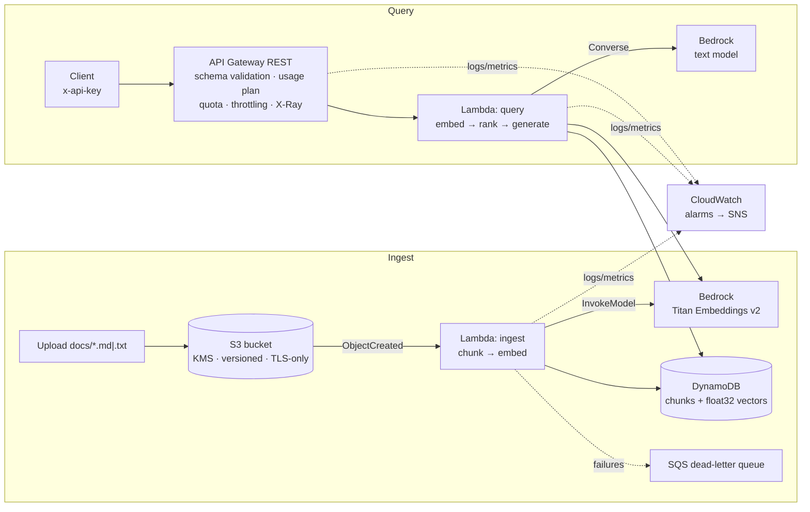

# Serverless RAG API on Amazon Bedrock

A small retrieval-augmented generation (RAG) service you can deploy in a few minutes. Drop a `.txt` or `.md` file into S3 and it is chunked, embedded with **Amazon Titan Embeddings v2** and stored in **DynamoDB**. Then `POST /ask` returns an answer grounded in those documents, with numbered citations, generated by a **Bedrock** model through the Converse API. API Gateway, Lambda (Python 3.12, arm64) and every IAM permission are defined in **Terraform**.

> A public rebuild of the pattern behind the first generative AI layer I designed for an emerging-markets financing platform: document embeddings on Bedrock, semantic retrieval behind API Gateway and Lambda, plugged into an existing app. No client code or data is included. Retrieval here is demo-scale by design; see *Scaling up*.

## Architecture



## What it demonstrates

| Area | Implementation |
| --- | --- |
| AI workload on AWS | Bedrock embeddings + Converse API (model-agnostic), grounded prompt with citations, refusal when the context lacks the answer |
| Least privilege | A separate role per function. `bedrock:InvokeModel` only on the two model ARNs, `s3:GetObject` only on `docs/*`, DynamoDB actions on one table, logs only to the function's own log group |
| Cost control (FinOps) | Per-key monthly quota and throttling in the usage plan, `maxTokens` cap, chunk cap per document, optional reserved concurrency, arm64 Lambdas, on-demand DynamoDB, 256-dimension embeddings stored as float32 bytes |
| API hardening | API key required, JSON-schema request validation at the gateway (rejected before Lambda runs), regional endpoint, stage throttling |
| Reliability | Dead-letter queue for failed ingestion, re-ingesting a document replaces its chunks, adaptive SDK retries |
| Observability | Structured JSON logs (latency, token usage, top similarity score), X-Ray across API Gateway and Lambda, access logs, alarms on Lambda errors, DLQ depth and API 5xx |
| Data protection | KMS-encrypted bucket with public access blocked and TLS-only policy, DynamoDB encryption and point-in-time recovery |
| Engineering practice | Pure retrieval logic in `src/rag.py` with unit tests. CI runs ruff, pytest, `terraform fmt`/`validate`, tflint and Checkov, then plan and apply over GitHub OIDC |

## Try it

```bash
# 0. In the Bedrock console, enable access to the embedding and text models for your region.

# 1. Bootstrap state + GitHub OIDC role (add -var create_oidc_provider=false if it already exists)
cd bootstrap && terraform init && terraform apply -var 'github_repo=Westace10/aws-bedrock-rag-api-terraform'

# 2. Deploy
cd ..
cp terraform.tfvars.example terraform.tfvars
cp backend.hcl.example backend.hcl
terraform init -backend-config=backend.hcl
terraform apply

# 3. Ingest a document
aws s3 cp sample-docs/returns-policy.md "s3://$(terraform output -raw docs_bucket)/docs/returns-policy.md"

# 4. Ask a question
KEY=$(aws apigateway get-api-key --api-key "$(terraform output -raw api_key_id)" --include-value --query value --output text)
curl -s -X POST "$(terraform output -raw api_url)" \
  -H "x-api-key: $KEY" -H "Content-Type: application/json" \
  -d '{"question": "How long do customers have to return a faulty item?"}' | jq
```

Example response:

```json
{
  "answer": "Faulty items can be returned within 12 months. If a repair isn't possible, the customer gets a replacement or a full refund [1].",
  "sources": [{ "ref": 1, "doc_id": "docs/returns-policy.md", "chunk_id": "00000", "score": 0.71 }]
}
```

Cost: there is no idle cost apart from pennies for storage. Each question costs one embedding call plus one short generation. Check [Bedrock pricing](https://aws.amazon.com/bedrock/pricing/) for your models.

## Run the tests

```bash
pip install -r requirements-dev.txt
ruff check src tests
pytest -q
```

## Scaling up

The query function scans DynamoDB and ranks vectors in memory. That keeps the demo free of always-on infrastructure, and it works for a few thousand chunks. For production volumes, replace `_load_chunks()` with a vector store (Amazon OpenSearch Serverless, Aurora PostgreSQL with pgvector, or S3 Vectors) or with a Bedrock Knowledge Base. Then add a Bedrock Guardrail, Cognito or IAM auth in place of API keys, and per-tenant document isolation.

## Licence

MIT
